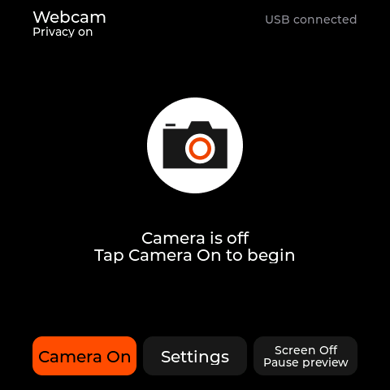
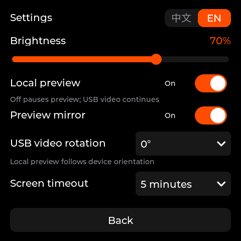

# Mosaico USB Webcam

English | [简体中文](README.zh-CN.md)

USB webcam firmware for ESP-Mosaico (ESP32-S31), using the USB Video Class (UVC) protocol. It provides a live touchscreen preview, privacy controls, and Chinese / English settings.

Use an SC101IOT camera module in the board's left H2 slot. Connect the computer to the High-Speed OTG USB-C port for video.

| Home | Settings |
| --- | --- |
|  |  |

Interface illustrations are rendered on a computer from the firmware's LVGL source.

## Features

- A single USB video mode: **MJPEG 640×480, targeting 25 FPS**.
- Privacy enabled at every startup; camera capture begins after tapping **Camera On**.
- Local preview and touch controls rotate with the device. The full camera view is scaled to fit, with borders where needed.
- Independent preview mirroring and USB video rotation: **0° / 90° / 180° / 270°**.
- Adjustable brightness, local preview, screen timeout, and interface language, saved across restarts.
- Camera connection guidance and automatic retries after camera errors.

## Usage

1. Install the camera module in the **left H2 slot** and connect a USB data cable to the **High-Speed OTG USB-C** port.
2. Tap **Camera On** on the device. Privacy is enabled at every startup, so the computer receives a black image until you turn the camera on.
3. Test with a built-in app below. The camera is named **Mosaico Webcam** or **UVC CAM1**.

| Computer | Quick test |
| --- | --- |
| Windows | Open **Start → Camera**. If it shows another camera, click **Change camera** in the top-right corner until the Mosaico image appears. See [Microsoft's instructions](https://support.microsoft.com/en-us/windows/hardware/camera/how-to-use-the-windows-camera-app). |
| macOS | Open **QuickTime Player → File → New Movie Recording**. Click the arrow beside the record button and select **Mosaico Webcam / UVC CAM1** under Camera. See [Apple's instructions](https://support.apple.com/guide/quicktime-player/record-a-movie-qtp356b55534/mac). |

Allow camera access if prompted. Wave in front of the lens to check that the image updates, then tap **Camera Off**: the image should turn black shortly afterward. You do not need to record a video.

Open **Settings** to adjust brightness, preview, mirroring, USB video rotation, or screen timeout. Preview mirroring affects only the device screen; USB video rotation changes the computer's image. Tap **中文 / EN** to switch languages.

Tap **Screen Off / Pause preview** to turn off the display while USB video continues. Touch the screen once to wake it. For detailed checks, see the [testing guide](TESTING.md).

## Flashing

For Iris installation, use `dist/mosaico-webcam-0.1.0.irisfw` in the official Iris installer or Ideas **Add Iris firmware** option. Enter Vibe Mode **0.2.0 or later** first; hold the **AI** button while restarting to enter it on devices with the official recovery bootloader. Back up application data before changing layouts. The package updates the partition table and application while preserving Vibe Mode and system data. This integration supports firmware installation only. USB remains UVC video; Iris previews and runtime control are not provided.

Build the firmware as described below to generate `dist/factory-merged.bin`. This full image is written at **`0x0`** and overwrites the existing firmware, partition layout, and non-volatile storage (NVS) settings within its range. Back up any data you need to keep.

1. Hold **BOOT** and reset or power-cycle the device to enter ROM download mode.
2. In an activated ESP-IDF environment with ESP32-S31 support, replace `PORT` with the confirmed download port and run:

   ```sh
   python -m esptool --chip esp32s31 --port PORT --no-stub \
     write-flash 0x0 dist/factory-merged.bin
   ```

3. Release BOOT and restart the device after flashing.

The runtime UVC interface is not a serial port. Use the board's download interface for flashing and UART at **115200 baud** for logs. The separate `dist/app.bin` is for compatible application-only updates; do not flash it at `0x0`. Image contents, offsets, and recovery instructions are in the [development guide](docs/DEVELOPMENT.md#bin-与烧录).

## Development

Use the **ESP-IDF 6.2 development revision pinned in [esp-idf.commit](esp-idf.commit)**. The board support package (BSP) requires ESP-IDF 6.2 or later; the project's build script also enforces the pinned SDK revision. A dedicated SDK installation is recommended because BSP camera patches modify SDK files.

With Espressif Installation Manager (EIM) installed, run from the repository root:

```sh
eim install -i 383dda6c182e3dabf6355160166fe007df775629 -t esp32s31 \
  --version-name webcam-idf-master -n true --do-not-track true
git submodule update --init
eim run 'sh tools/build.sh' webcam-idf-master
```

In an already activated matching SDK environment, run `sh tools/build.sh`. The script checks the SDK revision, applies the BSP display patch, builds the firmware, checks the linked USB descriptors, and packages the images and checksums into `dist/`.

Packaging uses the pinned official ESP-Mosaico Utils submodule and requires Python `cryptography` (`python -m pip install cryptography` in the SDK environment if missing). It produces both the `.irisfw` package and a full wired BIN containing Vibe Mode. Existing checkouts must select QIO Flash mode and application-confirmed rollback in `idf.py menuconfig`, or regenerate `sdkconfig` from the defaults; packaging rejects incompatible settings. The application now starts at `0x210000`; legacy `0x10000` application updates are incompatible.

```text
H2 camera → PPA rotation / scaling → hardware JPEG → USB UVC
                      └→ local preview → LVGL / TE-synchronized display
```

Build and diagnostic commands are in the [development guide](docs/DEVELOPMENT.md). See also [video processing and buffer management](docs/ARCHITECTURE.md), [dependencies and local modifications](docs/DEPENDENCIES.md), and the [testing guide](TESTING.md). These technical documents are in Chinese.

## Acknowledgments and licensing

Built with the official [ESP-Mosaico BSP](https://github.com/esp-mosaico/esp-mosaico-bsp), Espressif USB Device UVC, TinyUSB, LVGL, and Espressif's display presentation components. The camera icon comes from ESP-Mosaico Claw; Chinese glyphs are generated from Noto Sans CJK SC.

Project code is licensed under [Apache-2.0](LICENSE). Third-party components and artwork retain their respective licenses, including SIL OFL 1.1 for Noto Sans CJK. See the [dependency notes](docs/DEPENDENCIES.md) and the source and license files under `main/assets/` (`artwork-source/` in build packages).
