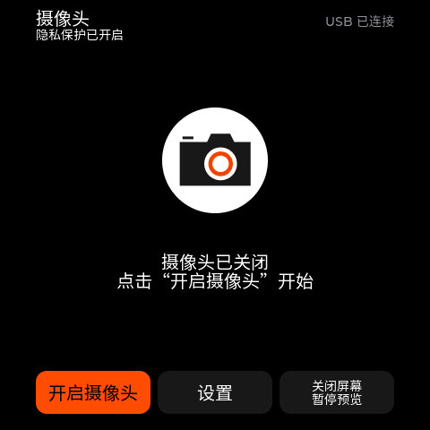
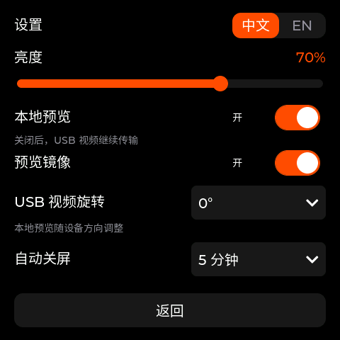

# Mosaico USB Webcam

[English](README.md) | 简体中文

将 ESP-Mosaico（ESP32-S31）用作 USB 摄像头，支持触摸屏预览和中英文操作。需要 SC101IOT 摄像头子板。

| 首页 | 设置 |
| --- | --- |
|  |  |

## 功能

- UVC MJPEG 视频：**640×480，目标 25 FPS**。
- 每次启动默认开启隐私保护，点击「**开启摄像头**」后开始采集。
- 本地预览与触摸界面随设备方向旋转。
- 预览镜像与 USB 视频方向独立设置，USB 支持 **0° / 90° / 180° / 270°**。
- 亮度、预览、自动关屏和语言设置在重启后保留。

## 安装

从 [Releases](https://github.com/eMUQI/esp-mosaico-webcam/releases/latest) 下载固件，安装前备份需要保留的数据，任选一种方式安装：

- **Iris 安装**：下载 `.irisfw` 安装包。按住 **AI** 键重启进入 Vibe Mode，通过官方 Iris 安装器或 Ideas「添加 Iris 固件」安装。需要 **Vibe Mode 0.2.0 或更新版本**。
- **有线烧录**：下载 `mosaico-webcam-0.2.0-factory-merged.bin`，按住 **BOOT** 并复位进入下载模式，通过主板下载接口将镜像写入 **`0x0`**，完成后松开 BOOT 并重启。此方式会覆盖原固件和设置。具体命令见[烧录说明](docs/DEVELOPMENT.md#bin-与烧录)。

## 使用

1. 将 SC101IOT 摄像头子板插入**左侧 H2 插槽**，用 USB 数据线连接电脑与设备的 **High-Speed OTG USB-C** 接口。
2. 点击设备上的「**开启摄像头**」。启动时默认开启隐私保护，此前电脑显示黑画面属于正常行为。
3. 在电脑的摄像头应用中选择 **Mosaico Webcam / UVC CAM1**：

| 电脑系统 | 打开摄像头 |
| --- | --- |
| Windows | 打开「**相机**」，通过「**切换摄像头**」选择设备。 |
| macOS | 打开 **QuickTime Player → 文件 → 新建影片录制**，在录制按钮旁的菜单中选择设备。 |

如提示摄像头权限，允许访问。点击「**关闭摄像头**」后，电脑画面切换为黑画面。

在「**设置**」中调整亮度、预览、镜像、USB 视频方向和自动关屏时间，点击「**中文 / EN**」切换语言。预览镜像只影响设备屏幕，USB 视频方向影响电脑画面。

点击「**关闭屏幕 / 暂停预览**」后，USB 视频继续传输；触摸屏幕一次即可唤醒。

## 开发

自行编译和调试见[开发指南](docs/DEVELOPMENT.md)，技术细节见[架构说明](docs/ARCHITECTURE.md)、[依赖说明](docs/DEPENDENCIES.md)和[测试指南](TESTING.md)。

## 致谢与许可

本项目使用官方 [ESP-Mosaico BSP](https://github.com/esp-mosaico/esp-mosaico-bsp)、Espressif USB Device UVC、TinyUSB 和 LVGL。摄像头图标来自 ESP-Mosaico Claw，中文字体源自 Noto Sans CJK SC。

项目代码采用 [Apache-2.0 许可](LICENSE)。第三方组件和素材遵循各自许可证，见[依赖说明](docs/DEPENDENCIES.md)及[素材来源与许可](main/assets/README.md)。
